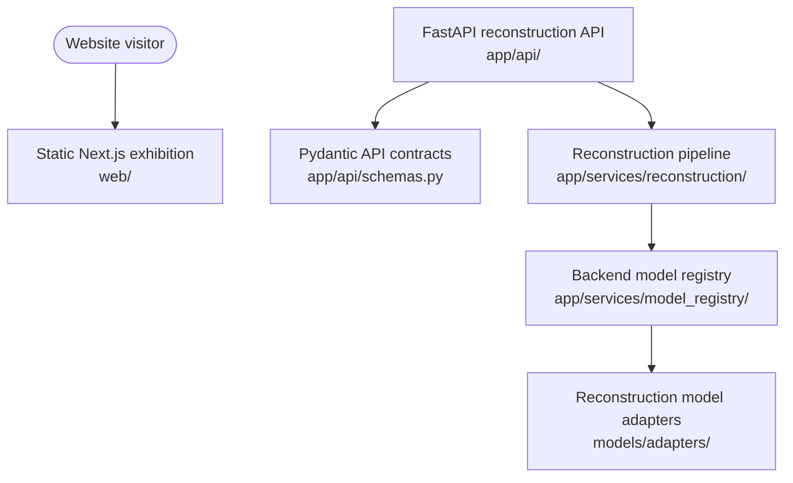

# ROOMAI — Indoor Spatial Reconstruction

> **Active ROOMAI website:** the static Next.js exhibition in [`web/`](web/README.md). It presents the current research system and does not run inference or render 3D assets in the browser.

**RoomAI** is an AI-powered indoor spatial reconstruction research system. Its static Next.js website presents the computational pipeline, evaluation evidence, limitations, and future directions. FastAPI reconstruction services and research infrastructure remain separate from the website.

---

## 🏛️ Architecture Overview

The system strictly decouples the UI presentation, service orchestration, schema validation, and machine learning models:



---

## 📁 Repository Structure

```
RoomAI/
├── web/                        # Static Next.js exhibition website
├── requirements.txt            # Python dependencies
├── README.md                   # System documentation & student guide
├── .gitignore                  # Git ignore rules (weights, caches, environments)
├── config/
│   ├── app.yaml                # UI, upload limits, mock mode toggle
│   └── model_config.yaml       # Checkpoint paths, thresholds, and classes
├── schemas/
│   ├── requests.py             # Pydantic input models (AnalysisRequest, DesignRequest, etc.)
│   └── responses.py            # Pydantic response models (BoundingBox, DetectionResponse, etc.)
├── utils/
│   ├── logging_config.py       # Standard structured logger
│   ├── image_validation.py     # Safe file inspection, corruption check & dimensions check
│   └── device.py               # GPU detection & VRAM memory accounting
├── models/
│   ├── interfaces.py           # Abstract Base Classes (BaseDetector, BaseClassifier, etc.)
│   ├── classification_model.py # Room style classification (CNN / ViT) + Mock
│   ├── detection_model.py      # Furniture object detection (BBoxes) + Mock
│   ├── segmentation_model.py   # Region semantic segmentation (Masks) + Mock
│   ├── vision_language_model.py# Visual Question Answering (VLM) + Mock
│   ├── generation_model.py     # Generative room redesign (Diffusion) + Mock
│   └── scene3d_model.py        # Experimental 3D depth estimation + Mock
├── services/
│   ├── image_service.py        # Box drawing, mask blending, depth heatmaps, comparisons
│   ├── detection_service.py    # Detection execution & schema validation
│   ├── segmentation_service.py # Segmentation execution & overlay generation
│   ├── classification_service.py # Style classification execution
│   ├── vision_language_service.py # VLM query execution
│   ├── generation_service.py   # Redesign generation & side-by-side composer
│   └── scene3d_service.py      # Experimental 3D depth orchestration
├── app/api/                    # FastAPI reconstruction endpoints
├── app/services/               # Reconstruction pipeline and backend services
├── tests/
│   ├── conftest.py             # Pytest fixtures (images, corrupted bytes)
│   ├── test_image_validation.py# Image validation tests
│   ├── test_schemas.py         # Request and response contract tests
│   ├── test_model_interfaces.py# Interface and mock execution tests
│   └── test_services.py        # Service orchestration & rendering tests
└── artifacts/
    ├── .gitkeep
    └── evaluation outputs      # Local model and pipeline artifacts
```

---

## ⚙️ Hardware Specifications & Constraints

- **Detected GPU:** NVIDIA GeForce RTX 4060 Laptop GPU
- **Physical VRAM:** 8.0 GB (8,188 MiB)
- **Usable Free VRAM:** ~7.3 GB (accounting for Windows Desktop Window Manager and system apps)
- **Host RAM:** 24 GB System RAM
- **CPU:** Intel Core i7 13th-Gen
- **OS:** Windows 11

### 💡 VRAM Memory Budgeting Rules for the RTX 4060:
1. **Precision:** Always use `torch.float16` or `torch.bfloat16` for inference to halve memory consumption.
2. **Sequential Execution:** Run vision tasks (classification, detection, segmentation) sequentially rather than holding multiple large models in GPU memory simultaneously.
3. **Diffusion Models:** If using Stable Diffusion or ControlNet for image generation, enable attention slicing (`pipe.enable_attention_slicing()`) and model offloading (`pipe.enable_model_cpu_offload()`). This keeps peak VRAM well under 6 GB.

---

## 🚀 Setup & Launch (Windows)

### 1. Prerequisites
Ensure Python 3.10+ (tested on Python 3.13) and Git are installed.

### 2. Create Virtual Environment
```powershell
# Open PowerShell in the project directory
cd c:\Users\apaar\Desktop\RoomAI

# Create virtual environment
python -m venv venv

# Activate virtual environment
.\venv\Scripts\Activate.ps1
```

### 3. Install Dependencies
```powershell
pip install -r requirements.txt
```

### 4. Run Pytest Suite
Verify application contracts, validation rules, and mock execution:
```powershell
pytest -v
```

### 5. Launch the static website

```powershell
cd web
npm install
npm run dev
```

Open `http://localhost:3000`. See [`web/README.md`](web/README.md) for the static site structure and content notes.

---

## 🧩 Student Guide: Implementing Your ML Models

Every model inherits from a base class defined in [`models/interfaces.py`](file:///c:/Users/apaar/Desktop/RoomAI/models/interfaces.py). When developing your model:
1. Implement the architecture in the designated file under `models/`.
2. Save your trained PyTorch/TensorFlow weights in `checkpoints/`.
3. Toggle `mock_mode: false` in `config/app.yaml` to run live inference through the backend tooling.

### A. Room Style Classifier
- **File:** [`models/classification_model.py`](file:///c:/Users/apaar/Desktop/RoomAI/models/classification_model.py)
- **Base Class:** `BaseClassifier`
- **Method to Implement:** `predict(image: Image.Image) -> ClassificationResponse`
- **Output Contract:**
  ```python
  ClassificationResponse(
      predicted_class="Living Room",
      confidence=0.92,
      top_classes=[
          ClassificationItem(class_name="Living Room", score=0.92),
          ClassificationItem(class_name="Bedroom", score=0.05),
          ClassificationItem(class_name="Dining Room", score=0.03),
      ],
      is_simulated=False,
      model_name="MyRoomViT-B16",
  )
  ```

### B. Furniture Object Detector
- **File:** [`models/detection_model.py`](file:///c:/Users/apaar/Desktop/RoomAI/models/detection_model.py)
- **Base Class:** `BaseDetector`
- **Method to Implement:** `predict(image: Image.Image, confidence_threshold: float) -> DetectionResponse`
- **Output Contract:**
  ```python
  DetectionResponse(
      detections=[
          DetectionItem(
              class_id=1,
              label="sofa",
              confidence=0.88,
              box=BoundingBox(x_min=0.15, y_min=0.45, x_max=0.75, y_max=0.85),
          )
      ],
      total_objects=1,
      is_simulated=False,
      model_name="MyFurnitureDetector",
  )
  ```

### C. Region Segmenter
- **File:** [`models/segmentation_model.py`](file:///c:/Users/apaar/Desktop/RoomAI/models/segmentation_model.py)
- **Base Class:** `BaseSegmenter`
- **Method to Implement:** `predict(image: Image.Image) -> Tuple[SegmentationResponse, np.ndarray]`
- **Output Contract:** Returns a tuple with metadata and a 2D integer numpy mask matching image dimensions `(height, width)`.

### D. Vision-Language Assistant (VLM)
- **File:** [`models/vision_language_model.py`](file:///c:/Users/apaar/Desktop/RoomAI/models/vision_language_model.py)
- **Base Class:** `BaseVisionLanguage`
- **Method to Implement:** `ask(image: Image.Image, question: str) -> VLMAnswerResponse`

### E. Generative Redesign Pipeline
- **File:** [`models/generation_model.py`](file:///c:/Users/apaar/Desktop/RoomAI/models/generation_model.py)
- **Base Class:** `BaseGenerator`
- **Method to Implement:** `generate(image: Image.Image, request: DesignRequest) -> Tuple[Image.Image, DesignGenerationResponse]`

### F. Experimental 3D Vision
- **File:** [`models/scene3d_model.py`](file:///c:/Users/apaar/Desktop/RoomAI/models/scene3d_model.py)
- **Base Class:** `BaseScene3D`
- **Method to Implement:** `reconstruct(image: Image.Image) -> Tuple[np.ndarray, Scene3DResponse]`

---

## ⚖️ Ethical AI & Honesty Disclaimers

The product includes a mandatory transparency disclaimer rendered across all redesign views:
> **Design Feasibility Notice:**
> RoomAI design concept generation does not preserve exact physical room dimensions, structural load-bearing walls, or physical manufacturing constraints. Generated visuals are creative concepts for aesthetic inspiration only.

When Mock Mode is enabled, the UI visually displays amber `[SIMULATED OUTPUT]` badges to prevent any ambiguity between synthetic tests and live AI models.

---

## 🗓️ Suggested Two-Day Development Timeline

| Timeframe | Target Milestone | Focus Area |
| :--- | :--- | :--- |
| **Day 1: Morning** | Room Classification (CNN & ViT) | Implement CNN baseline and Vision Transformer on indoor scene categories. Compare accuracy and attention maps. |
| **Day 1: Afternoon** | Object Detection | Train or fine-tune an anchor-based or DETR detector on indoor furniture (sofa, table, chair, lamp). Register in `models/detection_model.py`. |
| **Day 2: Morning** | Semantic Segmentation | Implement U-Net / SegFormer for architectural surfaces (floor, wall, ceiling). Connect mask rendering in `models/segmentation_model.py`. |
| **Day 2: Mid-Day** | Vision-Language Model | Connect a compact VLM (e.g. SmolVLM, BLIP-2, or LLaVA-1.5 7B with 4-bit quantization) for interactive room Q&A. |
| **Day 2: Afternoon** | Generative Redesign | Connect ControlNet / SD-img2img with condition guidance to generate aesthetic redesigns matching chosen styles. |
| **Day 2: Evening** | Integration, Testing & Review | Run full test suite (`pytest`), perform end-to-end user workflow validation, and prepare presentation. |
