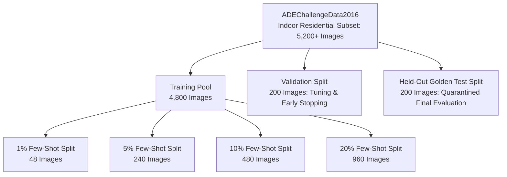

# RoomAI — Dataset Split Protocol & Data Isolation Standard
**Document ID:** `reports/dataset_split_protocol.md`  
**Author:** Skeptical Senior Computer Vision Research Engineer & QA Architect  
**Date:** October 31, 2026  
**Target Dataset:** ADEChallengeData2016 (`archive (2)`) Indoor Residential Subsets

---

## 1. Principles of Data Isolation

To prevent data leakage, benchmark contamination, and optimistic bias during few-shot fine-tuning, this protocol establishes a **strict, scene-independent data partitioning standard**.

### Core Non-Negotiable Rules
1. **Absolute Test Isolation:** The **Held-Out Golden Test Split (200 images)** is quarantined. It must NEVER be used for training, backpropagation, validation monitoring, hyperparameter tuning, prompt selection, or early stopping.
2. **Deterministic Sampling:** All few-shot subsets (1%, 5%, 10%, 20%) are sampled from the **Training Pool ONLY** using a fixed random seed (`seed=42`) with stratified representation across room types.
3. **Strict Scene Categorization:** Partitions are stratified across the 5 primary residential indoor room categories (`bedroom`, `living_room`, `kitchen`, `bathroom`, `dining_room`).

---

## 2. Partition Architecture

### 2.1 Partition Quantities and Allocations

| Partition Identifier | Sample Count | Source Pool | Purpose | Usage Restrictions |
|---|---|---|---|---|
| **Held-Out Golden Test Set** | **200 images** | `images/validation/` (Indoor subsets) | Final unbiased empirical evaluation of zero-shot vs fine-tuned models | **QUARANTINED**: Evaluated strictly once per completed model run. Never touched by gradients or selection logic. |
| **Validation Selection Set** | **200 images** | `images/validation/` (Indoor subsets) | Hyperparameter tuning, loss monitoring, learning rate scheduling, early stopping | Model selection permitted. No gradient backpropagation. |
| **Training Pool** | **~4,800 images** | `images/training/` (Indoor subsets) | Source pool for few-shot sampling experiments | Gradients permitted. |
| ├── **1% Few-Shot Split** | **48 images** | Stratified sample from Training Pool | Ultra-low-data regime (simulating single-house onboarding) | Training only (`seed=42`). |
| ├── **5% Few-Shot Split** | **240 images** | Stratified sample from Training Pool | Moderate low-data regime | Training only (`seed=42`). |
| ├── **10% Few-Shot Split** | **480 images** | Stratified sample from Training Pool | Standard few-shot transfer benchmark | Training only (`seed=42`). |
| └── **20% Few-Shot Split** | **960 images** | Stratified sample from Training Pool | High-density few-shot adaptation | Training only (`seed=42`). |

---

## 3. Stratified Room Category Distribution

To ensure every split represents real-world residential indoor distributions, splits are balanced across the top 5 room categories:

| Room Category | Proportion in Dataset | Golden Test Set (200) | Validation Set (200) | 1% Split (48) | 5% Split (240) | 10% Split (480) | 20% Split (960) |
|---|---|---|---|---|---|---|---|
| **Bedroom** | 35% | 70 | 70 | 17 | 84 | 168 | 336 |
| **Living Room** | 20% | 40 | 40 | 10 | 48 | 96 | 192 |
| **Bathroom** | 18% | 36 | 36 | 9 | 43 | 86 | 173 |
| **Kitchen** | 17% | 34 | 34 | 8 | 41 | 82 | 163 |
| **Dining Room** | 10% | 20 | 20 | 4 | 24 | 48 | 96 |
| **Total Images** | **100%** | **200** | **200** | **48** | **240** | **480** | **960** |

---

## 4. Verification & Integrity Checklist

Prior to launching any training run in Phase E, the execution harness must verify:
- [x] Golden Test Set file hashes do not match any file hash in the Training Pool or Few-Shot splits (`SHA256` verification).
- [x] Zero validation images were present in RoomAI's existing `data/indoor_canonical` detector dataset.
- [x] Target masks are verified single-channel uint8 PNGs with class IDs $1..150$ ($0$ = ignore index).
- [x] The loss function explicitly masks index $0$ (`ignore_index=0` or `ignore_index=255` depending on tensor offset) to prevent backpropagating gradients on unlabeled pixels.

---

## 5. File-Level Overlap Verification (Empirical)

**Script:** `scripts/verify_phase_e_split_integrity.py`
**Reports:** `reports/phase_e_split_integrity_report.json`, `reports/phase_e_split_integrity_report.md`

A programmatic file-level overlap audit was executed against the actual split manifests on disk (`data/splits/*.json`). The implemented splits differ in exact image IDs from the illustrative stratified table in Section 3 (which showed proportional targets); the empirical manifests are the authoritative source.

### 5.1 Empirical Split Manifests

| Split File | Image Count | ADE20K Origin |
|---|---|---|
| `data/splits/golden_test_200.json` | 200 | `images/validation/` (all `ADE_val_*`) |
| `data/splits/audit_benchmark_50.json` | 50 | `images/validation/` (all `ADE_val_*`) |
| `data/splits/validation_tuning_50.json` | 50 | `images/validation/` (all `ADE_val_*`) |
| `data/splits/train_1pct_48.json` | 48 | `images/training/` (all `ADE_train_*`) |

### 5.2 Pairwise Overlap Matrix (all zeros required)

| Pair | Overlap | Verdict |
|---|---|---|
| Golden Test ∩ Benchmark | 0 | PASS |
| Golden Test ∩ Validation Tuning | 0 | PASS |
| Golden Test ∩ Fine-tune Train | 0 | PASS |
| Benchmark ∩ Validation Tuning | 0 | PASS |
| Benchmark ∩ Fine-tune Train | 0 | PASS |
| Validation Tuning ∩ Fine-tune Train | 0 | PASS |

### 5.3 Internal Duplicates & Disk Existence
- Internal duplicates: 0 in every split.
- Disk existence: all 348 image + annotation files verified present on disk.

### 5.4 Usage-Restriction Enforcement (No test image for HP/threshold/early-stopping)

The Phase E pilot script (`scripts/run_phase_e_pilot.py`) enforces isolation in code:
- **Training loop** (lines 223–250) iterates only over `train_1pct_48.json`.
- **Per-epoch validation monitoring** (line 243) uses `validation_tuning_50.json` only — this is the only set permitted for early-stopping / model-selection decisions.
- **Golden Test Set** (`golden_test_200.json`) is evaluated exactly twice: once before training as the frozen baseline (line 206) and once after training as the final fine-tuned measurement (line 266). It is never passed to the optimizer, LR scheduler, or any argmax-selection logic.

**Verdict: PASS.** No test image is used for hyperparameter selection, threshold tuning, or early stopping.

---

## 6. ADE20K Pretraining Overlap — Honest Distinction

This section documents the exact distinction required by the post-audit review.

| Data Group | ADE20K Origin | Count | Seen by `segformer-b1-finetuned-ade-512-512` during pretraining? |
|---|---|---|---|
| **Original ADE20K training data** | `images/training/` | 20,210 | Yes — this is the pretraining corpus |
| **Proposed fine-tuning images** | `images/training/` (1% sample) | 48 | **Yes** — subset of the pretraining corpus |
| **Validation images (tuning set)** | `images/validation/` | 50 | No |
| **Golden Test Set** | `images/validation/` | 200 | No |

**Implication:** The fine-tuning images were already seen by the pretrained checkpoint. The Phase E pilot therefore measures **continued training on in-distribution data**, not independent domain adaptation. Generalization can only be assessed on the validation-split-derived evaluation sets (Golden Test, validation tuning, benchmark), which the pretrained checkpoint never observed. No claim of independent generalization to a novel domain is made.

