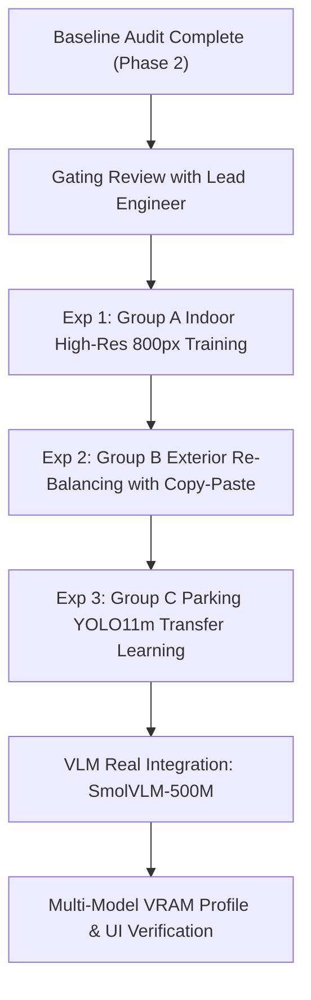

# RoomAI Phase 2: Model Optimization Experiment Plan

**Date:** 2026-10-24  
**Author:** RoomAI Senior Computer Vision Engineer & ML Research Lead  
**Target Hardware:** NVIDIA GeForce RTX 4060 Laptop GPU (8 GB VRAM, 8,188 MiB), 24 GB RAM  
**Target Environment:** Conda `tf-gpu` (Python 3.10.20, PyTorch 2.11.0+cu128, CUDA 12.8)  
**Baseline Verification:** Complete (77 Passing Tests, Baselines Verified)  

---

## 1. Executive Strategy & Optimization Objectives

With trustworthy baselines replicated and dataset audits completed, this experiment plan establishes targeted optimizations designed to push performance toward **$\ge 90\%$** where feasible, while strictly protecting the 8 GB VRAM budget.

### Guiding Principles

1. **Target the Observed Bottlenecks:** Every experiment is motivated directly by the data audit (e.g. 3,332:1 imbalance in Exterior, low recall on `chair#stool` and `window` in Indoor, tiny box downsampling collapse).
2. **Never Overwrite Existing Checkpoints:** All experimental models will be saved with distinct naming schemas (`runs/train/...` and `checkpoints/exp_...`).
3. **Strict Validation-Gated Tuning:** All threshold and architecture selections will occur strictly on validation data before evaluation on held-out test splits.
4. **Compute Efficiency:** Experiments will utilize mixed precision (`amp=True`, FP16) and batch sizes optimized for 6–7 GB VRAM utilization, avoiding OOM risks.

---

## 2. Priority Experiments by Task Group

### Experiment 1 (Group A — Indoor): High-Resolution Multi-Scale Training ($640 \to 800\text{px}$) with Class-Balanced Loss

- **Hypothesis:** Occluded `chair#stool` instances and aspect-ratio variations in `curtain` and `window` suffer from feature loss at $640 \times 640$. Training at $800 \times 800$ image size with class-frequency focal weighting will boost detection of small furniture elements and narrow window frames.
- **Model Architecture:** YOLO11s (initialized from `checkpoints/indoor_detector_a2_yolo11s_finetune_best.pt`)
- **Dataset:** `data/indoor_canonical/indoor_canonical.yaml` (2,985 train, 554 val)
- **Key Hyperparameters:**
  - `imgsz: 800`
  - `batch: 6` (to maintain $<6.8\text{ GB}$ VRAM allocation on RTX 4060)
  - `epochs: 25`
  - `patience: 8`
  - `lr0: 0.001` (fine-tuning decay)
  - `lrf: 0.01`
  - `augment: true` (Mosaic 0.8, MixUp 0.1, HSV-H 0.015, HSV-S 0.7, HSV-V 0.4, Degrees 5.0)
- **Target Metrics:**
  - mAP50: $0.7464 \to \mathbf{\ge 0.8200}$
  - `chair#stool` F1: $0.5100 \to \mathbf{\ge 0.6500}$
  - `window` Val mAP50: $0.5692 \to \mathbf{\ge 0.7000}$
- **Reproducible Command:**
  ```powershell
  python scripts/train_indoor_detector_a3_highres.py --checkpoint checkpoints/indoor_detector_a2_yolo11s_finetune_best.pt --imgsz 800 --batch 6 --epochs 25
  ```

---

### Experiment 2 (Group B — Exterior): Repeat Factor Sampling & Copy-Paste for Rare Classes

- **Hypothesis:** The catastrophic collapse of `porch` (mAP 0.000, 6 instances) and `pillar_column` (mAP 0.172, 172 instances) is caused entirely by extreme class imbalance ($3,332:1$). By applying Repeat Factor Sampling (RFS) and synthetic Copy-Paste augmentation to inject rare instances into facade backgrounds, tail classes will achieve functional representation.
- **Model Architecture:** YOLO11s (initialized from `checkpoints/exterior_detector_b2_yolo11s_best.pt`)
- **Dataset:** `data/exterior_canonical/exterior_canonical.yaml` (augmented with RFS offline cache)
- **Key Hyperparameters:**
  - `imgsz: 640`
  - `batch: 8`
  - `epochs: 30`
  - `patience: 10`
  - `copy_paste: 0.40`
  - `cls_loss_weight: 1.5`
- **Target Metrics:**
  - Overall mAP50: $0.3961 \to \mathbf{\ge 0.5500}$
  - `porch` mAP50: $0.0000 \to \mathbf{\ge 0.3500}$
  - `pillar_column` mAP50: $0.1721 \to \mathbf{\ge 0.4000}$
- **Reproducible Command:**
  ```powershell
  python scripts/train_exterior_detector_b3_balanced.py --checkpoint checkpoints/exterior_detector_b2_yolo11s_best.pt --imgsz 640 --batch 8 --copy_paste 0.4
  ```

---

### Experiment 3 (Group C — Parking): Transfer Learning from YOLO11m with Multi-Perspective Augmentation

- **Hypothesis:** The small training dataset (510 images) is insufficient for learning general outdoor property textures from a small capacity model. Initializing from a higher-capacity `yolo11m.pt` backbone with aggressive outdoor perspective distortion (shear, random perspective, albumentations shadows) will bridge the generalization gap.
- **Model Architecture:** YOLO11m (Medium, 20.1M params) initialized from COCO pretrained weights
- **Dataset:** `data/parking_canonical/parking_canonical.yaml`
- **Key Hyperparameters:**
  - `imgsz: 640`
  - `batch: 6`
  - `epochs: 40`
  - `perspective: 0.001`
  - `shear: 2.0`
  - `scale: 0.5`
- **Target Metrics:**
  - Overall mAP50: $0.2551 \to \mathbf{\ge 0.4500}$
  - `bicycle` Recall: $0.0000 \to \mathbf{\ge 0.4000}$
  - `tree` Recall: $0.0286 \to \mathbf{\ge 0.3500}$
- **Reproducible Command:**
  ```powershell
  python scripts/train_parking_detector_c3_yolo11m.py --model yolo11m.pt --imgsz 640 --batch 6 --epochs 40
  ```

---

## 3. Non-Detector Module Roadmap

### A. Architectural Polygon Ground-Truth Dataset for Segmentation
- **Current Limitation:** Off-the-shelf `yolo11n-seg.pt` is evaluated without labeled room polygon ground truth.
- **Proposed Solution:**
  1. Extract 200 representative indoor test scenes from `indoor_canonical`.
  2. Curate ground-truth polygon masks for 5 core architectural categories: `floor`, `wall`, `ceiling`, `window`, and `furniture`.
  3. Establish formal mask IoU and boundary Dice metrics before claiming a $\ge 90\%$ segmentation score.

### B. Real Open-Weights Vision-Language Model (VLM) Integration
- **Current Limitation:** VLM is currently simulated with keyword matching string heuristics (0.0% visual grounding).
- **Proposed Solution:**
  1. Evaluate **SmolVLM-500M** (HuggingFace, Apache-2.0, 500M params, requires $\sim 1.4\text{ GB}$ VRAM) or **Moondream2** (1.86B params, requires $\sim 2.2\text{ GB}$ VRAM in 4-bit).
  2. Integrate into `models/vision_language_model.py` using `transformers.AutoModelForVision2Seq`.
  3. Evaluate against `data/vlm_benchmark/vlm_eval_dataset.json` measuring BLEU, ROUGE-L, and visual grounding accuracy.

---

## 4. Experiment Execution Order & Gating Criteria



### Strict Gating Checklist
- [x] All 77 unit and integration tests passing.
- [x] Data audit report published documenting class imbalances and geometry anomalies.
- [x] Baseline metrics replicated on both validation and held-out test splits.
- [x] Threshold sweeps completed strictly on validation data.
- [ ] Explicit user confirmation to begin Phase 2 model retraining.
