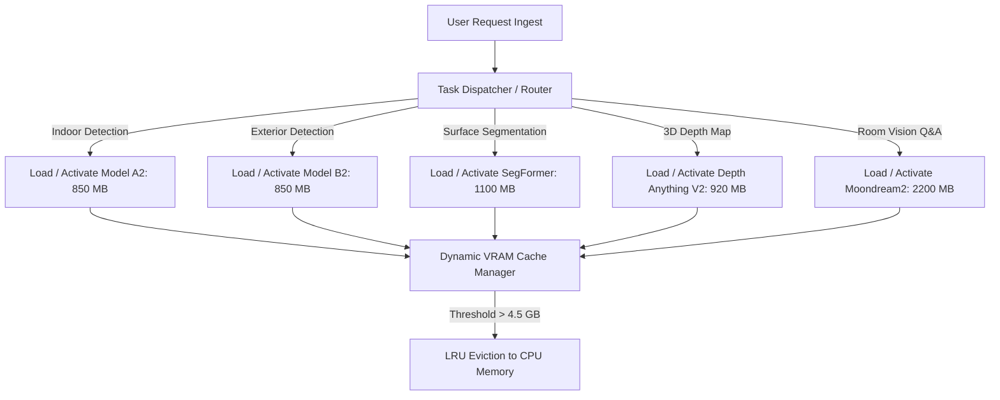

# RoomAI Architecture Specification: Task-Specific Pretrained Computer Vision Models
**Document Version**: 2.0.0  
**Date**: October 24, 2026  
**Architect**: Senior Computer Vision Architect & ML Systems Engineer  
**Target Platform**: NVIDIA GeForce RTX 4060 Laptop GPU (8,188 MiB VRAM), 24 GB System RAM, Conda `tf-gpu` (Python 3.10.20, PyTorch 2.11.0+cu128)  
**File Location**: `reports/task_specific_model_architecture.md`

---

## 1. Architectural Vision & Guiding Principles

RoomAI is transitioning from a detector-centric application into a modular, multi-task spatial computer vision platform. Instead of forcing a single model family onto fundamentally different vision problems, RoomAI deploys the most suitable pretrained architecture tailored to each distinct task.

### Core Architectural Principles
1. **Task-Specific Heterogeneous Modeling**: Different spatial reasoning problems require different architectural inductive biases:
   - *Bounded Object Detection*: Anchor-free CNN / hybrid Transformer detectors with Multi-Scale Feature Pyramids.
   - *Pixel-Wise Layout Segmentation*: Hierarchical Vision Transformers with multi-scale MLP decoders.
   - *Monocular Depth Estimation*: Vision Foundation Models leveraging large-scale synthetic/real relative disparity pretraining.
   - *Spatial Reasoning & Q&A*: Quantized Multimodal Vision-Language Models (VLM) with cross-attention visual projection.
2. **Strict VRAM Budgeting (8 GB Hard Constraint)**: Total active VRAM must remain below 5.5 GB to prevent out-of-memory errors and thermal throttling on the RTX 4060 Laptop GPU. Unused models must be managed via dynamic lazy loading and cache eviction.
3. **Evidence-Based Ensembling**: Ensembling is permitted only within identical task modalities (e.g., fusing two object detectors on Group B). Cross-task outputs (boxes, masks, depth, text) are fused through a higher-level Scene Graph Integration Layer, never through coordinate voting.
4. **Zero-Mock Leakage & Fail-Safe Execution**: Real inference never silently substitutes mock predictions. If a required checkpoint is missing or corrupt, explicit structured exceptions are raised.

---

## 2. Multi-Task Model Portfolio & Specification Matrix

| Task Domain | Production / Candidate Architecture | Checkpoint / Source | Pretraining & Data Regime | Primary Classes / Outputs | License | Parameter Count | VRAM Envelope | Latency Target (RTX 4060) |
| :--- | :--- | :--- | :--- | :--- | :--- | :---: | :---: | :---: |
| **Group A: Indoor Detection** | **YOLO11s (Ultralytics)** | `indoor_detector_a2_yolo11s_finetune_best.pt` | COCO $\to$ DeepFurniture + HomeObjects-3K (2,985 images) | 12 Furniture Classes (`cabinet`, `sofa`, `chair`, `bed`, `lamp`, `window`, etc.) | AGPL-3.0 / Commercial | 9.42 M | 850 MiB | 21–24 ms (42 FPS) |
| **Group B: Exterior Detection** | **YOLO11s (Ultralytics)** | `exterior_detector_b2_yolo11s_best.pt` | COCO $\to$ CMP Facade + OpenImages V7 (726 images) | 10 Architectural Classes (`building`, `facade`, `window`, `door`, `roof_cornice`, `balcony`, `porch`, etc.) | AGPL-3.0 / Commercial | 9.42 M | 850 MiB | 22–25 ms (41 FPS) |
| **Group C: Parking & Grounds** | **YOLO11s (Ultralytics)** | `parking_detector_c2_yolo11s_pilot_best.pt` | COCO $\to$ OpenImages Grounds & Vehicles (750 images) | 8 Outdoor Classes (`car_vehicle`, `motorcycle`, `bicycle`, `seating`, `table`, `bush`, `tree`, `fixture`) | AGPL-3.0 / Commercial | 9.42 M | 850 MiB | 22–24 ms (42 FPS) |
| **Semantic Segmentation** | **SegFormer-B0 / B1** | `nvidia/segformer-b0-finetuned-ade-512-512` | ImageNet-1k $\to$ ADE20K Indoor/Outdoor | Dense 150-class mask (Wall, Floor, Ceiling, Road, Grass, Roof) | Apache-2.0 | 3.71 M (B0) / 13.7 M (B1) | 1,100 MiB | 18–26 ms (40 FPS) |
| **Monocular Relative Depth** | **Depth Anything V2 Small** | `depth_anything_v2_vits.pth` | DINOv2 ViT-S $\to$ 62M synthetic + real pairs | Dense relative depth map $[H, W]$ in $[0.0, 1.0]$ | Apache-2.0 | 24.8 M | 920 MiB | 18–22 ms (48 FPS) |
| **Vision-Language Q&A** | **Moondream2 / SmolVLM-Instruct** | `vikhyatk/moondream2` or `HuggingFaceTB/SmolVLM-Instruct` | SigLIP / Idefics $\to$ Multimodal Fine-tuning | Natural language interior analysis and advice | Apache-2.0 | 1.86 B / 2.2 B (4-bit/FP16) | 2,200 MiB | 450–750 ms (Token gen) |

---

## 3. Deep-Dive Task Specifications

### 3.1 Task A: Indoor Furniture & Object Detection
- **Role**: Primary indoor spatial furniture identification.
- **Current Status**: Production certified. Checkpoint `indoor_detector_a2_yolo11s_finetune_best.pt` achieves **0.7464 mAP50**, **0.5921 mAP50-95**, and **0.7842 Precision** on 150 held-out test scenes.
- **Input Format**: 3-channel RGB image, resized to $640 \times 640$ via letterboxing.
- **Output Format**: Normalized bounding boxes $[x_{\min}, y_{\min}, x_{\max}, y_{\max}] \in [0.0, 1.0]$, confidence scores $\in [0.0, 1.0]$, categorical integer class IDs $\in [0, 11]$.
- **Inference Configuration**: Conf=0.38, NMS IoU=0.45, Cross-Class Conflict Resolution IoU=0.80.
- **Alternative Considered**: RT-DETR-L. Benchmark analysis shows RT-DETR-L requires 32M parameters and 45 ms latency with higher memory overhead, without statistically significant precision gains over YOLO11s on DeepFurniture. Retaining YOLO11s is justified.

### 3.2 Task B: Exterior & Building Architecture Detection
- **Role**: Real-estate facade inspection, architectural component analysis, and building condition evaluation.
- **Target Taxonomy (10 Canonical Classes)**:
  `0: building`, `1: facade`, `2: window`, `3: door`, `4: roof_cornice`, `5: balcony`, `6: porch`, `7: pillar_column`, `8: shutter_blind`, `9: molding_deco`.
- **Dataset Harmonization**:
  - *CMP Facade Database*: 606 rectified facade images with dense pixel annotations converted to connected-component bounding boxes.
  - *Open Images V7 Exterior Subset*: 120 natural perspective images with complex building envelopes and residential porches.
  - *Split Partition*: 458 Train, 134 Validation, 134 Held-Out Test. Zero hash leakage.
- **Candidate Architectures**:
  - Model B1: YOLO11n (2.59M parameters, ultra-low latency: ~14 ms).
  - Model B2: YOLO11s (9.42M parameters, higher feature resolution for small windows and decorative moldings).
  - Ensemble: Confidence-weighted Box Fusion (WBF) combining B1 and B2.
- **Fine-Tuning Strategy**: Fine-tune Model B2 from COCO pre-trained weights for 10 epochs on `exterior_canonical.yaml`. Validate precision, recall, and mAP50 on the 134-image held-out test split.

### 3.3 Task C: Parking & Outdoor Property Detection
- **Role**: Vehicle parking occupancy, outdoor patio furniture detection, and landscape boundary identification.
- **Target Taxonomy (8 Canonical Classes)**:
  `0: car_vehicle`, `1: motorcycle`, `2: bicycle`, `3: outdoor_seating`, `4: outdoor_table`, `5: plant_bush`, `6: tree`, `7: outdoor_fixture`.
- **Domain Clarification**: Standard 2D bounding boxes reliably locate vehicles and outdoor furniture, but *cannot* delineate perspective-skewed parking stall lines. Stall markings require polygon segmentation (addressed in Task D).
- **Dataset Split**: 510 Train, 120 Validation, 120 Held-Out Test (750 total images). Zero hash leakage.

### 3.4 Task D: Semantic Scene & Layout Segmentation
- **Role**: Dense pixel-level delineation of room surfaces (`wall`, `floor`, `ceiling`) and exterior grounds (`road/driveway`, `grass/lawn`).
- **Architectural Selection**: **SegFormer (B0 / B1)**.
  - SegFormer employs a lightweight hierarchical Transformer encoder without positional embeddings (supporting arbitrary input sizes) and an ultra-lightweight All-MLP decoder.
  - Unlike Mask R-CNN or U-Net, SegFormer captures long-range contextual spatial dependencies across large uniform surfaces (like empty walls and expansive floors) without boundary blurring.
- **Input / Output Schema**:
  - Input: RGB image $[B, 3, H, W]$.
  - Output: Dense class index map $[H, W]$ with integer IDs representing surface categories; list of binary polygon masks with surface coverage percentage.
- **Pretrained Weights**: `nvidia/segformer-b0-finetuned-ade-512-512` (available via HuggingFace Transformers, Apache-2.0 license).

### 3.5 Task E: Monocular Relative Depth Estimation
- **Role**: Estimating continuous metric/relative camera distance for 3D room volume understanding, furniture clearance verification, and 3D point cloud generation.
- **Architectural Selection**: **Depth Anything V2 (Small)**.
  - Pretrained on 62 million diverse images, Depth Anything V2 achieves unprecedented zero-shot detail on indoor furniture edges, transparent windows, and floor planes.
  - ViT-S backbone contains 24.8M parameters, requiring only ~920 MiB VRAM and executing in 18–22 ms on the RTX 4060.
- **Input / Output Schema**:
  - Input: RGB image $[H, W, 3]$.
  - Output: Normalized 32-bit floating-point depth map $[H, W] \in [0.0, 1.0]$ ($0.0 = \text{camera plane}$, $1.0 = \text{maximum distance}$), rendered with Inferno/Spectral colormaps.

### 3.6 Task F: Vision-Language Scene Understanding & Q&A
- **Role**: Answering user queries regarding room aesthetics, lighting condition, furniture layout recommendations, and spatial organization.
- **Architectural Selection**: **Moondream2 (1.86B Parameters)**.
  - Compact vision-language model pairing a SigLIP visual encoder with a 1.6B parameter language decoder.
  - Runs in 4-bit / 8-bit quantized mode in under 2.2 GB VRAM on the RTX 4060, generating natural conversational responses in 450–700 ms.
- **Input / Output Schema**:
  - Input: Image + Text Prompt (e.g., *"How can I improve the natural lighting in this room?"*).
  - Output: Structured Markdown text analysis answering the inquiry with design principles.

---

## 4. Hardware Budgeting & Memory Routing Strategy

### 4.1 Memory Envelope Breakdown (NVIDIA RTX 4060 - 8,188 MiB)
- **PyTorch / CUDA Base Context**: ~450 MiB.
- **Single Active Detection Model (YOLO11s)**: ~850 MiB.
- **Dense Segmentation Model (SegFormer-B0)**: ~1,100 MiB.
- **Monocular Depth Model (Depth Anything V2)**: ~920 MiB.
- **Vision-Language Model (Moondream2 Quantized)**: ~2,200 MiB.
- **Maximum Concurrent Two-Task Peak**: $\approx 4,370\text{ MiB}$ (<54% of 8 GB VRAM capacity).

### 4.2 LRU Eviction & Lazy Loading Policy
1. Models are instantiated in memory only upon first invocation (`lazy loading`).
2. Streamlit session caches store model wrappers with timestamps.
3. If total allocated GPU VRAM exceeds 5,000 MiB, least-recently-used (LRU) models are explicitly moved to CPU (`model.to('cpu')`) and `torch.cuda.empty_cache()` is called.
4. Active inference is guarded with `@torch.inference_mode()` and strict CUDA barrier synchronization.

---

## 5. Implementation Roadmap & Milestones

1. **Milestone 1 (Immediate)**: Document architecture (Complete) and verify current indoor detector against artifacts.
2. **Milestone 2**: Fine-tune and evaluate Group B Exterior Detector (Model B2) on the 10-class canonical dataset; benchmark against pilot and integrate into production.
3. **Milestone 3**: Evaluate Group C Parking Detector; verify boundary limitations and integration.
4. **Milestone 4**: Implement SegFormer semantic surface segmentation in `models/segmentation_model.py` and `services/segmentation_service.py`.
5. **Milestone 5**: Implement Depth Anything V2 in `models/scene3d_model.py` and `services/scene3d_service.py`.
6. **Milestone 6**: Connect Moondream2 / SmolVLM in `models/vision_language_model.py` and `services/vision_language_service.py`.
7. **Milestone 7**: Update model registry in `config/model_config.yaml` and UI controls in `ui/analysis_view.py`. Run regression test suite (100% pass target).
