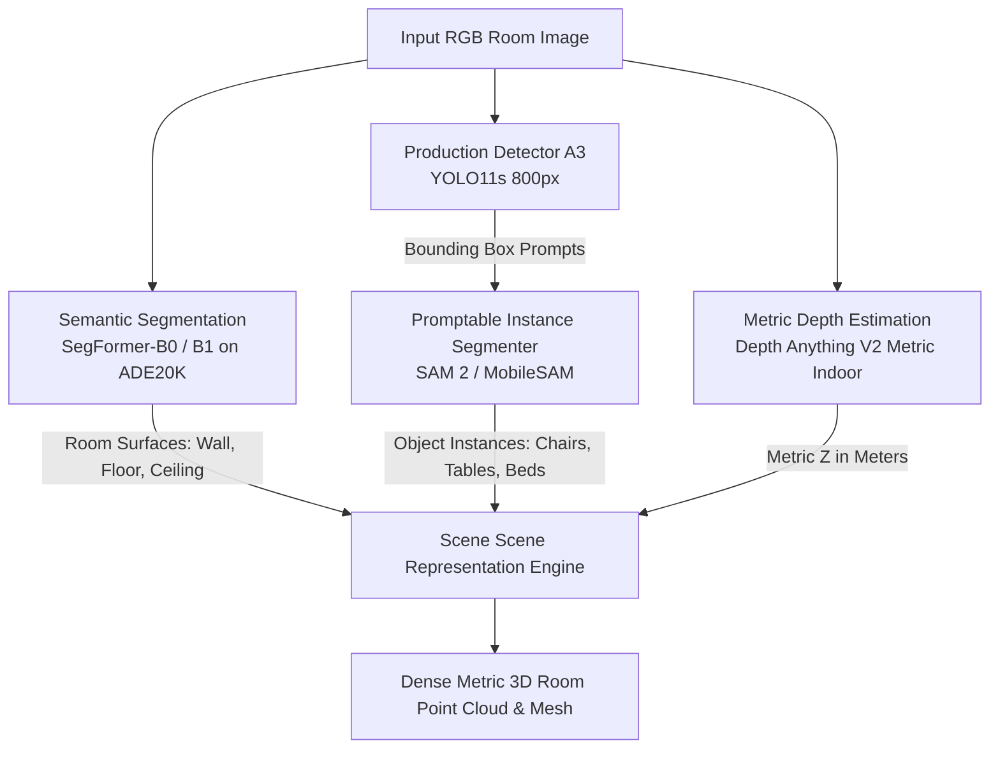

# RoomAI — Vision Model Asset Inventory & Data Audit Report
**Phase A Deliverable**  
**Date:** October 31, 2026  
**Auditor:** Principal Computer Vision Research Engineer & ML Systems Architect  
**Hardware Profile:** NVIDIA GeForce RTX 4060 Laptop GPU (8 GB VRAM), 24 GB System RAM, Windows 11  
**Software Environment:** `tf-gpu` Conda Environment (Python 3.10.20, PyTorch 2.5+, Ultralytics, Transformers 4.45+)

---

## 1. Executive Summary

This inventory report audits all visual data assets, downloaded repositories, and existing annotation resources in the RoomAI workspace (`F:\RoomAI`). The objective is to establish an empirical foundation for modernizing RoomAI's visual perception stack from standalone, uncoordinated detection/segmentation/depth modules to an integrated, state-of-the-art scene-understanding and 3D-reconstruction pipeline.

### Discovered Asset Summary Table

| Asset Identifier | Asset Type | Root Location | Size / Samples | Annotation Format | Pretrained Weights | Direct RoomAI Applicability |
|---|---|---|---|---|---|---|
| **ADEChallengeData2016** (`archive (2)`) | Semantic Segmentation Dataset | `F:\RoomAI\archive (2)\ADEChallengeData2016` | 22,210 images (20,210 train, 2,000 val) | Single-channel 8-bit PNG (`0`=unlabeled, `1..150`=classes) | N/A (Ground Truth) | **CRITICAL / IMMEDIATE**: Solves wall, floor, ceiling, and structural surface segmentation. Ideal for few-shot fine-tuning and benchmarking. |
| **ScanNet-master** | Research Codebase & Benchmark Tools | `F:\RoomAI\ScanNet-master\ScanNet-master` | 14 directories, C++/Python codebase | NYUv2 40-label set, Cityscapes-style format | **NONE** (No checkpoints bundled) | **REFERENCE ONLY**: Provides benchmark scripts & NYUv2 40 mapping, but requires institutional sign-up for raw `.sens` scans. |
| **DeepFurniture** | Object Detection Dataset | `F:\RoomAI\data\deepfurniture` | 1,000 scenes, 28,606 objects | YOLO bounding-box format (`class_id cx cy w h`) | Used for Detector A3 | **DETECTION ONLY**: High-quality indoor furniture boxes, but zero pixel/polygon masks. Cannot train segmentation models directly without pseudo-labeling. |
| **Indoor Canonical** | Detection Evaluation Set | `F:\RoomAI\data\indoor_canonical` | 1,000 images (800 train, 200 val) | YOLO bounding-box format (12 classes) | Used for A3 validation | **DETECTION BENCHMARK**: Used to validate Detector A3 bounding boxes for downstream promptable segmentation. |

---

## 2. In-Depth Audit: ADEChallengeData2016 (Semantic Segmentation)

### 2.1 File Structure & Integrity
The dataset is unpacked under `F:\RoomAI\archive (2)\ADEChallengeData2016`:
```
ADEChallengeData2016/
├── images/
│   ├── training/          [20,210 JPEG images: ADE_train_00000001.jpg .. ADE_train_00020210.jpg]
│   └── validation/        [2,000 JPEG images: ADE_val_00000001.jpg .. ADE_val_00002000.jpg]
├── annotations/
│   ├── training/          [20,210 PNG mask files: ADE_train_00000001.png .. ADE_train_00020210.png]
│   └── validation/        [2,000 PNG mask files: ADE_val_00000001.png .. ADE_val_00002000.png]
├── objectInfo150.txt      [TSV of 150 semantic categories with Name, Ratio, Class ID]
└── sceneCategories.txt    [22,210 lines mapping every image filename to scene category]
```
Verification confirmed 100% paired correspondence: every training and validation image has a matching annotation mask with identical pixel dimensions.

### 2.2 Annotation Specification
- **Image Format:** RGB JPEG images with varied indoor resolutions (typically ~512 to 800 px on longest edge).
- **Mask Encoding:** Single-channel 8-bit unsigned integer PNG images (`uint8`).
  - Class index `0`: Background / unlabeled / out-of-vocabulary regions.
  - Class index `1` to `150`: Standard ADE20K semantic classes.
- **Palette Mapping:** Standard MIT ADE20K palette is defined in `objectInfo150.txt`.

### 2.3 Indoor Scene Distribution
Analysis of `sceneCategories.txt` reveals a total of 22,210 annotated scenes, of which indoor residential scenes form a dominant cluster:
- `bedroom`: 1,528 scenes
- `living_room`: 767 scenes
- `bathroom`: 738 scenes
- `kitchen`: 728 scenes
- `dining_room`: 454 scenes
- `conference_room`: 184 scenes
- `hotel_room`: 176 scenes
- `office`: 145 scenes
- `corridor`: 137 scenes
- `home_office` / `entryway` / `playroom`: ~400+ additional scenes

**Total Indoor Residential Images:** > 5,200 curated room scenes. This provides more than enough real-world indoor variation for room boundary extraction and few-shot fine-tuning.

### 2.4 Class Alignment with RoomAI Requirements
The current RoomAI pipeline fails because generic COCO models (like YOLO11n-seg) only segment COCO foreground objects and completely omit structural elements. The ADE20K 150-class taxonomy solves this gap:

| Architectural / Room Region | ADE20K Class ID | ADE20K Class Name | RoomAI Importance |
|---|---|---|---|
| **Wall** | `1` | `wall` | **Critical**: Room perimeter, layout estimation, plane extraction |
| **Floor** | `4` | `floor, flooring` | **Critical**: Ground plane equation, object support surface |
| **Ceiling** | `6` | `ceiling` | **Critical**: Room height, volume boundary |
| **Window** | `9` | `windowpane, window` | **High**: Natural lighting sources, exterior cutouts |
| **Door** | `15` | `door, double door` | **High**: Room ingress/egress, boundary transitions |
| **Curtain** | `19` | `curtain, drape` | **Medium**: Window covering, interior styling |
| **Rug / Carpet** | `29` | `rug, carpet` | **High**: Floor texture, aesthetic decoration |
| **Column** | `43` | `column, pillar` | **Medium**: Structural indoor support |
| **Stairs** | `54` | `stairs, steps` | **Medium**: Multi-level floor transitions |

Furthermore, ADE20K provides dense classes for all 12 RoomAI furniture categories:
- `bed` (`8`), `cabinet` (`11`), `table` (`16`), `chair` (`20`), `sofa` (`24`), `shelf` (`25`), `armchair` (`31`), `desk` (`34`), `wardrobe` (`36`), `lamp` (`37`), `coffee table` (`65`), `nightstand` (`64`), `plant` (`5`), `painting/picture` (`23`), `television` (`90`).

---

## 3. In-Depth Audit: ScanNet-master

### 3.1 Codebase Structure
The repository at `F:\RoomAI\ScanNet-master\ScanNet-master` contains official tooling for the ScanNet benchmark (Dai et al., CVPR 2017):
- `BenchmarkScripts/`: Contains Cityscapes-style 2D and 3D evaluation scripts (`evaluate_semantic_label.py`, `evaluate_semantic_instance.py`).
- `SensReader/`: C++ reader to decompress `.sens` format RGB-D streams into color frames, depth maps, camera poses, and calibration matrices.
- `Tasks/`: Data export scripts for NYUv2 40-class benchmarks.
- `LICENSE`: Strictly non-commercial, academic research terms.

### 3.2 Evaluation of Usability for RoomAI
1. **No Checkpoint Weights:** The repository contains zero pretrained model weight files (`.pt`, `.pth`, `.onnx`, or `.safetensors`).
2. **No Bundled Data:** ScanNet data consists of ~2.5 TB of raw RGB-D scans which require submitting an institutional Terms of Service agreement to the ScanNet benchmark organizers before receiving a download script.
3. **Legacy Dependency:** Evaluation scripts are written for Python 2.7.
4. **Architectural Utility:** While it cannot provide immediate inference out-of-the-box, its class mapping (`scannetv2-labels.combined.tsv` -> NYUv2 40 classes) and camera projection scripts provide an exact mathematical blueprint for unprojecting 2D depth maps into metric 3D point clouds.

---

## 4. In-Depth Audit: Existing RoomAI Detection Datasets

### 4.1 Datasets: DeepFurniture & Indoor Canonical
- `data/deepfurniture`: Contains 1,000 indoor scenes with 28,606 bounding boxes across 12 classes (`cabinet#shelf`, `table`, `chair#stool`, `lamp`, `door`, `bed`, `sofa`, `plant`, `decoration`, `curtain`, `home-appliance`, `window`).
- `data/indoor_canonical`: Canonical benchmark split (800 train, 200 val) used to train and validate production Model A3 (YOLO11s, 800px, mAP50 = 0.697).

### 4.2 Key Structural Constraint
- **Annotations are pure bounding boxes:** `[class_id, x_center, y_center, width, height]` normalized to $[0, 1]$.
- **Zero Segmentation Masks:** There are no polygon boundaries, RLE masks, or raster masks in either dataset.
- **Critical Architectural Consequence:**
  1. We **cannot** train or fine-tune an instance segmentation model (e.g., Mask R-CNN or YOLO11-seg) from scratch directly on RoomAI's existing annotations without prior mask synthesis.
  2. Bounding boxes cannot simply be converted into solid rectangular masks (as this causes massive background bleeding and degrades downstream 3D surface reconstruction).
  3. **The Optimal Architectural Solution:** Implement a **Detection-Guided Foundation Model Ensemble**. Model A3 outputs high-precision 2D bounding boxes; these bounding boxes serve as geometric prompts to a zero-shot promptable segmentation model (SAM 2 / FastSAM / MobileSAM), producing pixel-perfect instance segmentation masks without requiring manual polygon annotation.

---

## 5. Strategic Implications for RoomAI Perception Architecture

Based on this audit, RoomAI's visual perception pipeline should be structured into three complementary, non-competing tracks:



1. **Semantic Surface Understanding (ADE20K Pretrained):**
   - Extract wall, floor, ceiling, and window boundaries with SegFormer-B0 / Mask2Former.
   - ADE20K provides 5,200+ indoor scenes with ground-truth structural masks.
2. **Object Instance Understanding (A3 + Promptable SAM):**
   - Preserve Model A3 as the primary indoor detector.
   - Pass A3 bounding boxes to SAM 2 or MobileSAM for crisp, zero-shot instance masks.
3. **Metric Depth Estimation (Depth Anything V2 Metric Indoor):**
   - Upgrade from relative depth (0..255) to metric depth ($Z$ in meters) using `Depth-Anything-V2-Metric-Indoor-Small-hf`.
   - Combine metric depth with semantic masks to create real-world 3D point clouds and plane equations for walls and floors.

